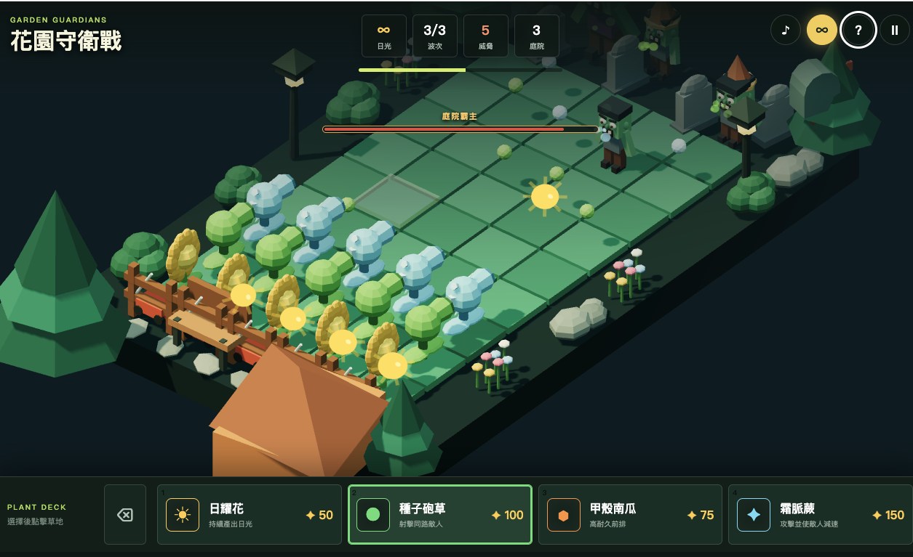

# 花園守衛戰 Garden Guardians

《花園守衛戰》是一款原創的 3D 五路塔防網頁遊戲。玩家需要收集日光、種植不同能力的植物，阻止夜行殭屍穿過草坪進入庭院。

完整產品、玩法與技術規格請參考 [`DESIGN.md`](./DESIGN.md)。

## 關於這個遊戲

颱風天閒著沒事，趕在 ChatGPT-5.6 Sol 發表的當下，想試試最新模型能做出什麼花樣，於是敲了這款小品遊戲出來。

從場景構想到程式實作，全程帶著玩票性質——低多邊形 3D、三種隨機場景、三波殭屍進攻跟 Boss 戰，都是邊寫邊加的。雖然只是個小東西，但每一行程式碼都塞了滿滿的熱情（跟咖啡因）。

[🎮 線上遊玩](https://bowwowxx.github.io/plant-game/)

遊戲採用低多邊形 3D 美術風格，包含五路九格戰場、三波敵人、裝甲殭屍、Boss、推草機、背景音樂及完整的滑鼠、鍵盤與觸控操作。



## 遊戲內容

- **3D 花園戰場**：草坪、房屋、柵欄、墓碑、樹木、花圃、路燈、信箱與庭院擺設皆使用 Three.js 即時繪製。
- **隨機場景**：每次開始遊戲會從月夜森林、秋日庭園與海岸晨曦中隨機選擇遠景。
- **五路九格防線**：植物與敵人依照同一套 3D 格位及路線系統運作。
- **三波進攻**：每一波的敵人數量、生命值與移動速度都會增加。
- **敵人種類**：包含普通殭屍、裝甲殭屍，以及第三波固定登場的「庭院霸主」Boss。
- **Boss 戰**：Boss 擁有 1200 點生命、較高攻擊力、專屬模型與畫面上方的生命條。
- **日光系統**：收集天空掉落或日耀花產生的日光，用來種植植物。
- **冷卻系統**：植物使用後需要等待冷卻才能再次種植。
- **推草機防線**：每條路線都有一台推草機，可在敵人突破時清除該路線上的敵人。
- **鏟除工具**：可連續移除多株植物，一般模式會回收植物價格的 25%。
- **音樂與音效**：包含循環背景音樂，以及種植、射擊、收集、攻擊和 Boss 登場音效。
- **測試模式**：可開啟無限日光與零冷卻，方便測試配置及遊戲內容。

## 隨機場景

遊戲會在頁面首次載入時隨機選擇一張遠景，重新開始下一局時也會自動更換，而且不會連續兩局使用相同場景。

目前包含三種原創低多邊形 3D 遠景：

- **月夜森林**：星空、月亮、松林、山脈與暖色庭園燈。
- **秋日庭園**：夕陽、紅葉、山谷、石燈與遠方木橋。
- **海岸晨曦**：海岸、島嶼、涼亭、岩壁與日出天空。

遠景圖片只負責場外環境；可玩草坪、植物、殭屍、Boss、光源與陰影仍由 Three.js 即時繪製，因此更換圖片不會影響格位、選取或遊戲操作。

## 植物

| 植物 | 花費 | 功能 |
| --- | ---: | --- |
| 日耀花 | 50 | 定時產生 25 點日光，是主要資源來源。 |
| 種子砲草 | 100 | 對同一路線前方的敵人發射種子。 |
| 甲殼南瓜 | 75 | 擁有高耐久度，可阻擋敵人並保護後排植物。 |
| 霜脈蕨 | 150 | 發射寒霜種子，造成傷害並暫時降低敵人速度。 |

## 玩法

1. 選擇下方植物卡片，再點擊空的草坪格子種植。
2. 點擊場上的日光球，或按下 `C` 一次收集所有日光。
3. 在不同路線配置攻擊、資源與防禦植物。
4. 敵人接近植物時會停下攻擊，植物生命歸零後會被移除。
5. 不要讓敵人通過左側防線；庭院生命歸零時遊戲結束。
6. 擋下三波進攻並擊敗「庭院霸主」即可完成防守。

## 操作方式

### 滑鼠與觸控

- 點擊植物卡片選擇植物。
- 點擊草坪格子種植。
- 點擊日光球收集日光。
- 點擊鏟子按鈕後，可連續點擊植物將其移除。
- 使用滑鼠右鍵可直接鏟除該格植物。

### 鍵盤

| 按鍵 | 功能 |
| --- | --- |
| `1`–`4` | 選擇對應的植物。 |
| 方向鍵 | 移動目前選取的草坪格子。 |
| `Enter` | 在選取格種植；鏟子模式下則移除植物。 |
| `C` | 收集場上所有日光。 |
| `X` | 開啟鏟子模式並移除選取格植物。 |
| `Space` | 暫停或繼續遊戲。 |
| `Esc` | 取消目前的植物或工具選擇。 |

### 畫面按鈕

- `♪`：開啟或關閉背景音樂與音效。
- `∞`：切換無限日光、零冷卻測試模式。
- `?`：開啟遊戲說明。
- `Ⅱ`：暫停或繼續遊戲。

## 技術內容

- HTML5
- CSS3 響應式介面
- JavaScript ES Modules
- Three.js 3D 場景、模型、光源、陰影與射線選格
- Canvas 2D 日光、粒子與畫面特效
- Web Audio API 背景音樂與音效
- Local Storage 最高分紀錄

## 本機執行

ES Modules 需要透過 HTTP 伺服器載入。請在專案目錄執行：

```bash
python3 -m http.server 4173
```

接著開啟：

```text
http://localhost:4173
```


## 專案結構

```text
plant/
├── index.html          # 遊戲介面與 HUD
├── styles.css         # 響應式版面與 UI 樣式
├── game.js            # 遊戲規則、波次與操作邏輯
├── three-scene.js     # Three.js 場景、3D 模型與動畫
├── assets/            # 專案美術與概念素材
├── vendor/            # 專案內使用的 Three.js 模組
└── .nojekyll          # GitHub Pages 靜態檔案設定
```

## 授權說明

Three.js 依其原始 MIT License 使用。專案中的遊戲程式、名稱與低多邊形模型為此專案建立；正式公開發佈前，建議另外加入適合的 `LICENSE` 檔案，明確標示程式碼的使用條款。
